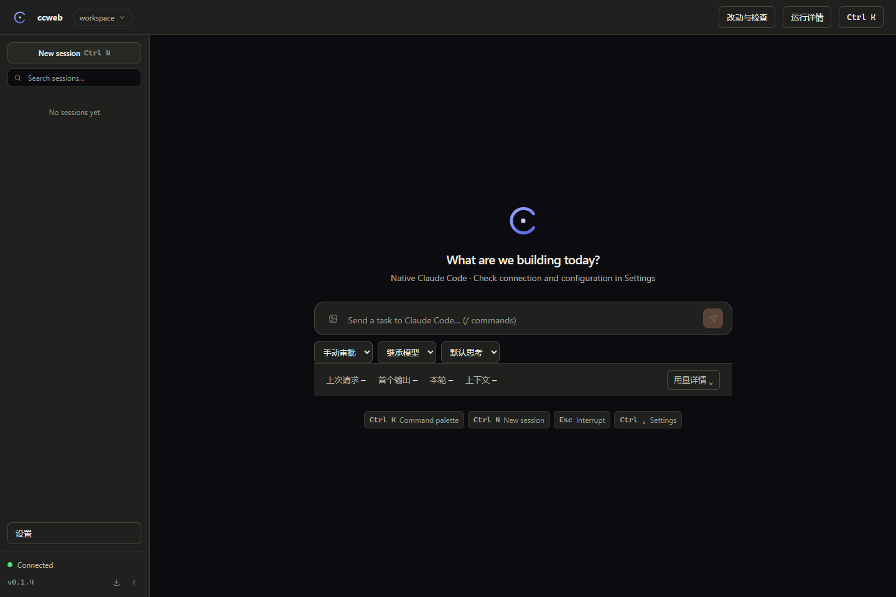
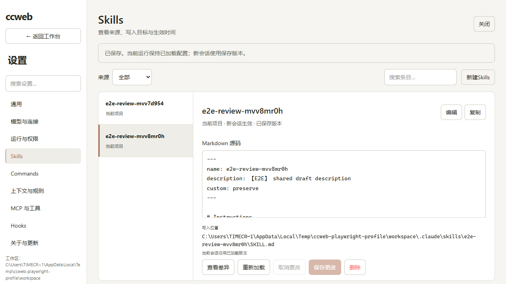
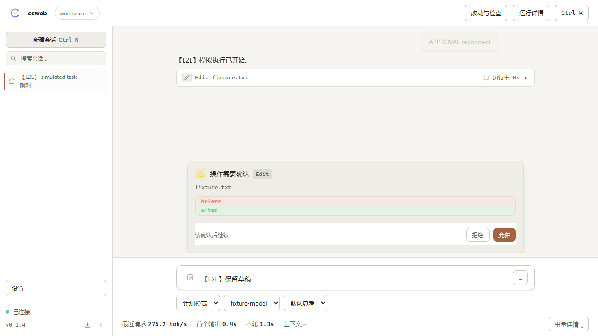

<div align="center">

# ccweb

**Professional local web console for Claude Code**

**[English](#english)** | 中文

基于官方 Agent SDK 随包的 **Claude Code runtime**，提供本地图形客户端。配置按所选来源和原生能力加载；终端专属操作有明确边界。

[](https://www.npmjs.com/package/ccweb-console)
[](#license)
[](#快速开始)

`npx ccweb-console` → 打开 `http://127.0.0.1:3477`，就这么简单。



</div>

---

## 它解决什么问题

终端里的 Claude Code 很强，但长会话缺一层**图形化的管理与观测**。ccweb 基于官方 **Claude Agent SDK** 驱动真正的 Claude Code 子进程，把这一层补齐。

## 架构

<div align="center">

</div>

## 功能

| | 功能 | 说明 |
|---|---|---|
| 💬 | **完整对话 GUI** | markdown + 代码高亮、thinking 折叠、消息分叉（fork）、重新生成 |
| 🔧 | **工具调用卡片** | Read/Grep 行号展示、Edit 行级 diff 预览（红删绿增）、Bash 输出 ANSI 着色、耗时统计 |
| 🛡 | **可视化审批** | 允许、拒绝、停止，审批刷新后可继续；反问支持单选、多选和自由回答 |
| 📬 | **消息队列** | 生成中发送自动排队：可见、可撤销、成功结束后继续；中断或失败暂停，用户明确恢复 |
| 📊 | **实时指标** | 常驻 tok/s、首个输出、轮次耗时和原生上下文；按请求配对实际输出 Token 与输出阶段耗时，SDK 费用标为估算 |
| 🧭 | **上下文水位** | 原生上下文水位；累计 Token 用量与上下文占用分别展示 |
| 🗂 | **会话管理** | 搜索 / resume / fork / 改名 / 删除 / 拖拽排序 / 历史回放；服务重启不自动重新执行未完成任务 |
| ⌨️ | **补全** | `/` 斜杠命令（含自定义 skills）、`@` 工作区文件路径 |
| ⚙️ | **全图形设置** | 九类配置中心；Skills / Commands / 规则原生文件编辑、来源筛选、差异确认、冲突检测、备份；MCP / Hooks 配置与诊断 |
| 🌓 | **双主题 · 中英双语** | 默认跟随系统；进程内会话快照重建与请求回执 |
| 💾 | **一键导出** | 完整对话含工具调用，导出 Markdown |

## 快速开始

当前 V2 为源码实现，尚未发布到 npm。`npx ccweb-console` 运行的是已发布版本；体验本轮改动请从源码构建或安装本地 tarball。


```bash
# Node 20+；SDK 自带 claude 二进制，无需单独安装 CLI
npx ccweb-console
```

浏览器打开 `http://127.0.0.1:3477`。API 端点沿用环境里的 `ANTHROPIC_BASE_URL` / `ANTHROPIC_AUTH_TOKEN`，或在设置页切换已配置的端点模板——凭证不出本地。

<details>
<summary>从源码运行</summary>

```bash
git clone https://github.com/TimeCraker/ccweb && cd ccweb
pnpm install && pnpm build && node apps/server/bin/ccweb.mjs
```

```bash
pnpm dev      # 并行起 server(3477) + web(5173, WS 代理)
pnpm check    # lint + typecheck + test + build 质量门
```
</details>

## 键盘快捷键

| 按键 | 动作 |
|---|---|
| `Ctrl+K` | 命令面板（命令 / 会话 / 工作区） |
| `Ctrl+N` / `Ctrl+B` | 新建会话 / 折叠侧栏 |
| `Ctrl+,` | 设置 |
| `Esc` | 中断生成 / 关闭弹层 |
| `Enter` / `Shift+Enter` | 发送 / 换行（生成中 Enter = 排队） |
| `/` `@` | 斜杠命令 / 文件路径补全 |

## V2 实际截图

| 工作台 | 配置管理 |
|---|---|
|  |  |



截图来自实际浏览器。审批图使用确定性 SDK 模拟；真实模型证据和限制见 [产品诊断的 V2 验收](https://github.com/TimeCraker/ccweb/blob/main/docs/PRODUCT_AUDIT.md#v2-实施与验收2026-10-31)。

<details>
<summary>Troubleshooting</summary>

- **换工作区后模型仍知道其他项目的内容**：设置 → 运行与权限选择配置来源，原生 `settingSources` 对新会话生效。空来源不等于安全沙箱；环境、登录、恢复历史等来源独立存在
- **会话列表为空**：确认顶部工作区是实际跑会话的目录；Windows 路径已自动归一化
- **端口冲突**：`CCWEB_PORT=3999 npx ccweb-console`
- **切换端点模板后不生效**：端点设置对新会话生效，当前会话沿用启动时环境
</details>

## License

MIT © TimeCraker

> 本项目为社区第三方工具，与 Anthropic 无关联；Claude 为 Anthropic 商标。

---

## English

English | **[中文](#它解决什么问题)**

**ccweb** is a professional, open-source web console for Claude Code — built on the official **Claude Agent SDK**, it drives a real Claude Code runtime behind a full GUI. Configuration follows the selected native setting sources and runtime capabilities; terminal-only actions remain explicit.

```bash
npx ccweb-console   # Node 20+; bundles its own claude binary
```

Open `http://127.0.0.1:3477`. Endpoint credentials come from your environment (`ANTHROPIC_BASE_URL` / `ANTHROPIC_AUTH_TOKEN`) or any configured template in Settings.

### Highlights

- 🖥 **Full GUI** — markdown + syntax highlighting, tool-call cards (Read/Grep with line numbers, Edit with line-level diff, ANSI-colored Bash output), collapsible thinking, fork & regenerate
- 🛡 **Visual approvals** — confirm dangerous actions in-app; AskUserQuestion as tab UI; reconnectable allow/deny controls and explicit interruption
- 📬 **Message queue** — queued, visible, cancelable; resumes after successful turns; interruption or errors pause the queue
- 📊 **Live metrics** — paired actual output tokens and output-phase duration, separate first-content latency and turn time; SDK costs are estimates
- 🧭 **Context gauge & trajectory** — usage ring with proactive warning above 85%; right-panel timeline of every tool call
- 🗂 **Sessions** — search / resume / fork / rename / delete / drag-reorder; history survives server restarts
- 🌓 Dark & light themes · bilingual UI (中文/English) · session snapshot reconstruction and command receipts

## 运行与升级边界

- ccweb 使用 SDK 随包运行时，不自动替换为本机 CLI。SDK 精确版本由 lockfile 和包清单共同锁定。
- 默认配置、运行指标、计划和私有临时目录保存在 `~/.ccweb`；`CCWEB_HOME` 可覆盖。原生配置目录支持 `CLAUDE_CONFIG_DIR`。
- 会话显式采用官方 `claude_code` 系统提示预设，避免 SDK 精简默认值造成行为差异。
- 模型、权限支持原生热切；端点、effort、配置来源对新会话生效。界面同时保留默认值和当前会话快照。
- 自动模式按运行时、模型和账号支持情况确认；不映射为跳过审批。运行一切需明确开启，服务重启后恢复手动审批。
- `/plan`、`/model`、`/clear`、`/new`、`/settings`、`/mcp`、`/help` 为 GUI 操作；发现的原生命令交给 SDK。登录、终端设置、安装升级等操作需终端。
- 费用为 SDK 估算，输出速度不包含请求之间的工具或审批等待。没有完整样本时不显示伪造数值；旧历史无统计时显示未记录。
- Dependabot 每周提出升级 PR；CI 验证契约、原生二进制、浏览器和实际 tarball 安装。配置提交到默认分支后才会在 GitHub 生效，不能保证未来任何上游版本自动兼容。

本地验证：`pnpm check`、`pnpm --filter ccweb-console test:runtime`、`pnpm --filter @ccweb/web exec playwright test`。后者包含明确标记的模拟 SDK 流程，不消耗模型额度。真实模型验收单独记录。
