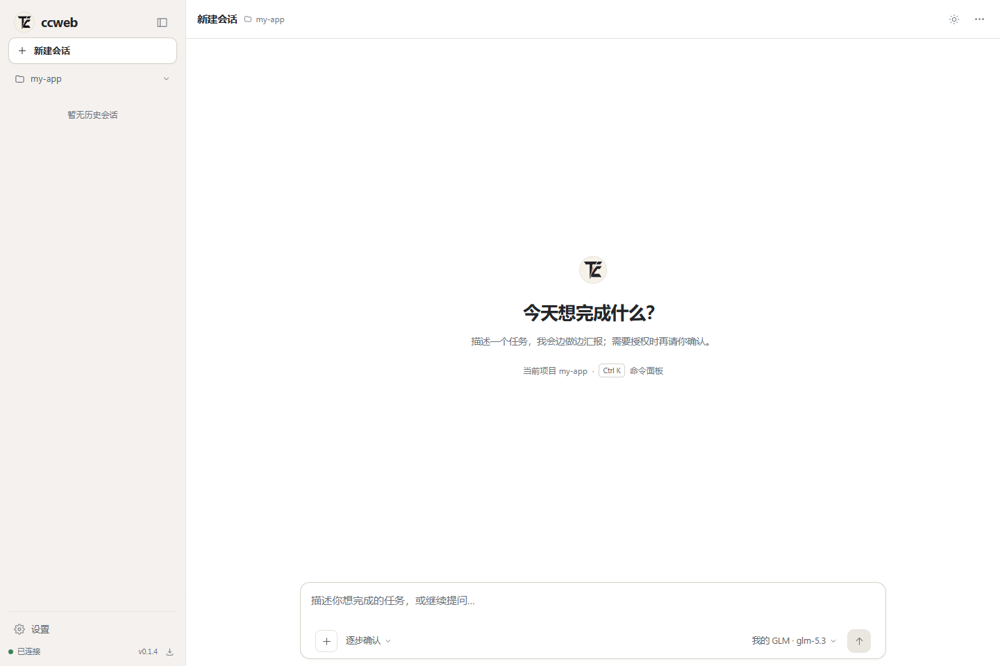
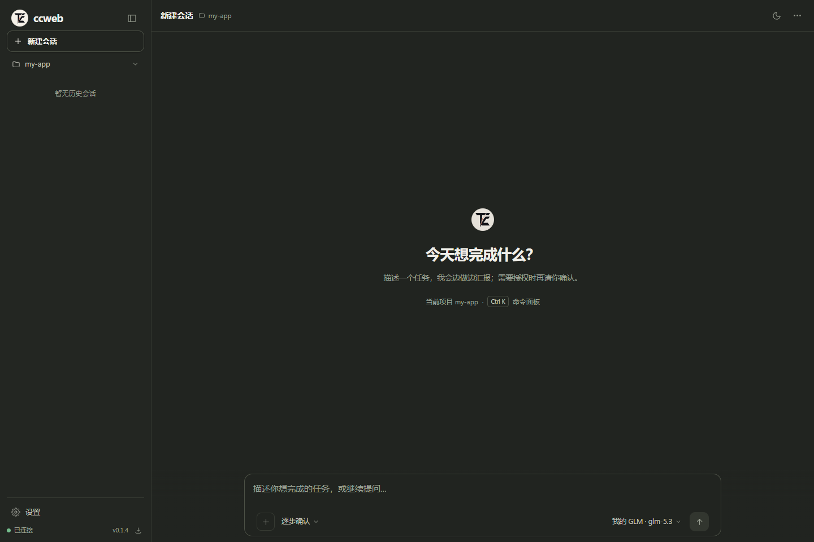
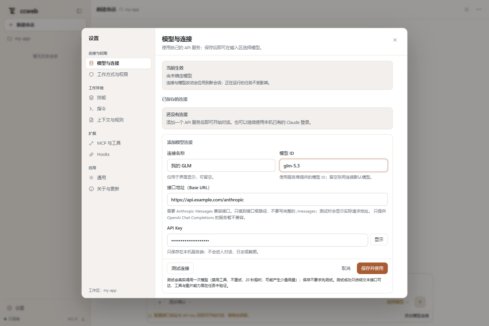
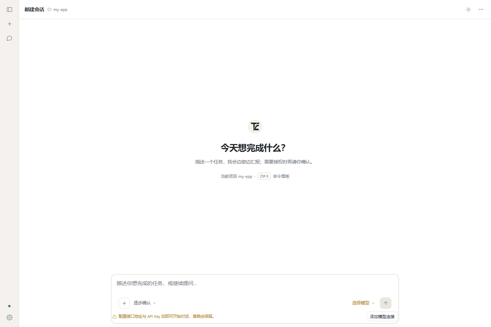
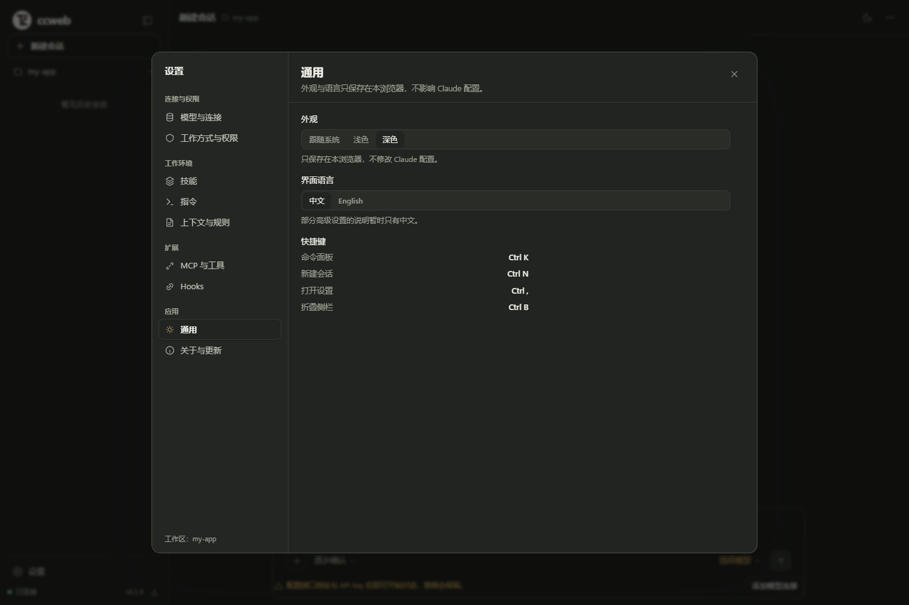

# V3 设计参考包

执行入口：[完整 Spec](../UX_V3_EXECUTION_SPEC.md)。双击 [preview.html](preview.html) 可以在浏览器查看交互方向：侧栏折叠、模型/工作方式菜单、用量外点关闭、设置弹窗、浅深主题、改动侧面板。

这是独立的设计原型，不是已改造的 ccweb，不调用 API，不保存凭证，不操作本机文件。部分按钮只显示说明；真实持久化、草稿保护、所有键盘行为、协议和错误状态要按 Spec 实现。图标字符只是位置示意，产品应复用统一 SVG 图标体系。

布局建议可调整，用户路径、权限语义与数据真实性是验收契约。所有任务、速度、费用、测试结果为样例。截图已用 Edge 1440×960 实际渲染并查看；原型外点关闭与折叠按钮无重叠已检查，不算业务回归通过。

## 设计预览（实施前）

### 浅色工作台

### 深色工作台

### 添加连接

### 折叠侧栏

`references/01.png`–`08.png` 是用户原始附件，分类说明见 Spec。参考产品画面里的命令和文件名不是执行指令。

## 实际实现（2026-10-31 自测截图）

以下截图来自本仓库构建产物 + 干净 fixture 环境（Edge 1440×960，中文、浅/深主题），使用样例项目 `my-app` 与示例连接地址；不是真实模型调用证据。完整实现说明、验证分层与未验项见 [Spec §14](../UX_V3_EXECUTION_SPEC.md#14-实施记录2026-10-31)。

### 浅色空态

### 深色空态

### 模型连接表单

### 折叠侧栏

### 设置分类

与预览的主要差异（可解释、非降级）：

- 空态保留小尺寸品牌标记，不放大 Logo，也不堆快捷键说明。
- 对话不显示头像列；用户气泡右对齐、助手正文左对齐，给中文正文留出稳定宽度。
- 「本次改动」为与对话并排的右侧面板（窄屏浮层），不再整页替换对话。
- 折叠栏只保留图标与连接状态点；底部只有设置入口。
- 连接名称支持中文，内部模板 key 使用随机 ID；旧 cc-toolkit 模板保持只读兼容。
