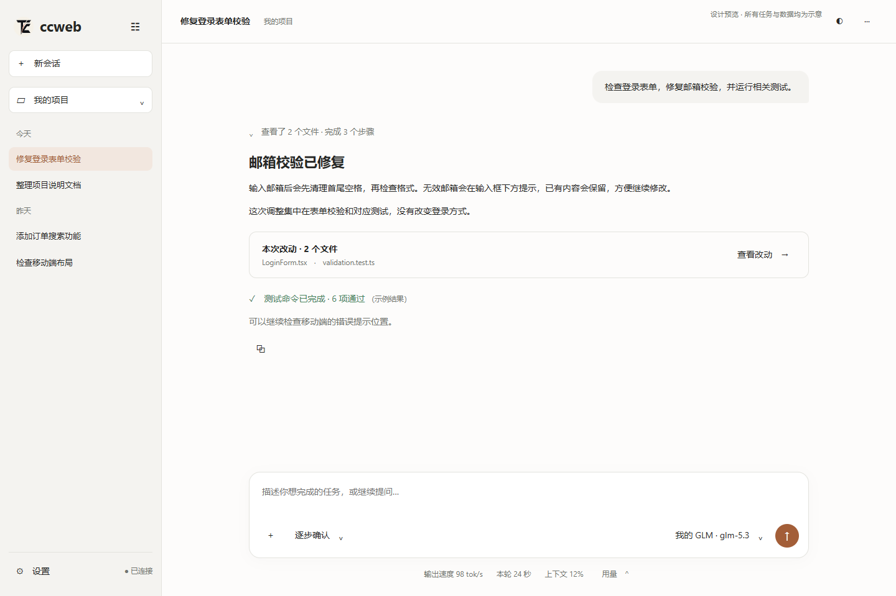
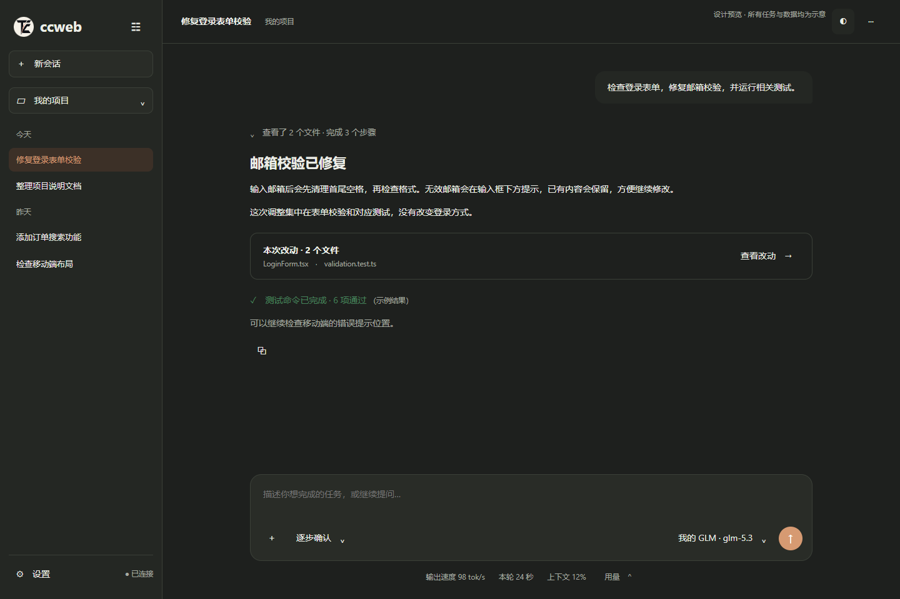
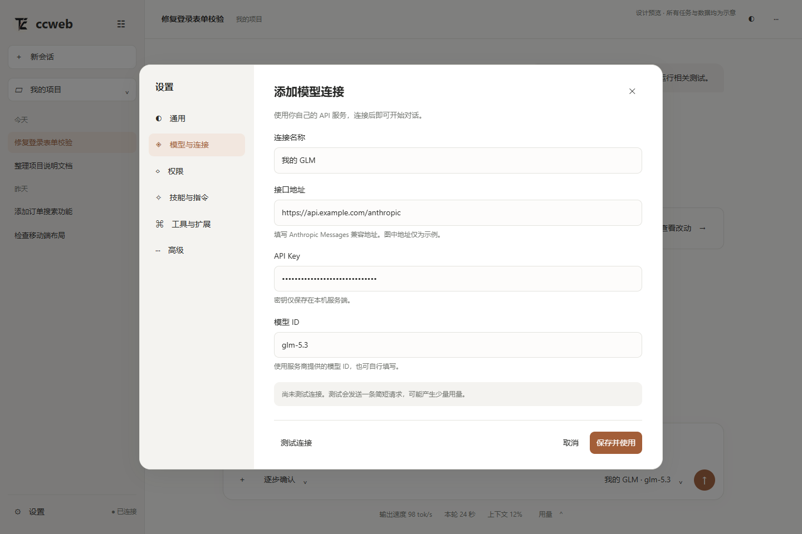
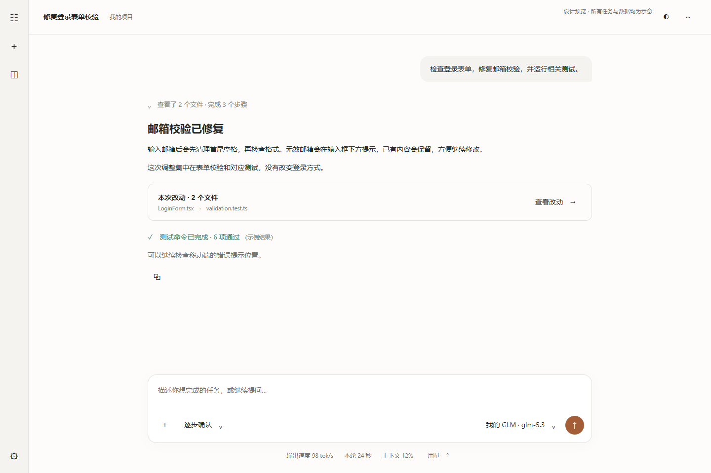

# V3 设计参考包

执行入口：[完整 Spec](../UX_V3_EXECUTION_SPEC.md)。双击 [preview.html](preview.html) 可以在浏览器查看交互方向：侧栏折叠、模型/工作方式菜单、用量外点关闭、设置弹窗、浅深主题、改动侧面板。

这是独立的设计原型，不是已改造的 ccweb，不调用 API，不保存凭证，不操作本机文件。部分按钮只显示说明；真实持久化、草稿保护、所有键盘行为、协议和错误状态要按 Spec 实现。图标字符只是位置示意，产品应复用统一 SVG 图标体系。

布局建议可调整，用户路径、权限语义与数据真实性是验收契约。所有任务、速度、费用、测试结果为样例。截图已用 Edge 1440×960 实际渲染并查看；原型外点关闭与折叠按钮无重叠已检查，不算业务回归通过。

## 浅色工作台

## 深色工作台

## 添加连接

## 折叠侧栏

`references/01.png`–`08.png` 是用户原始附件，分类说明见 Spec。参考产品画面里的命令和文件名不是执行指令。
